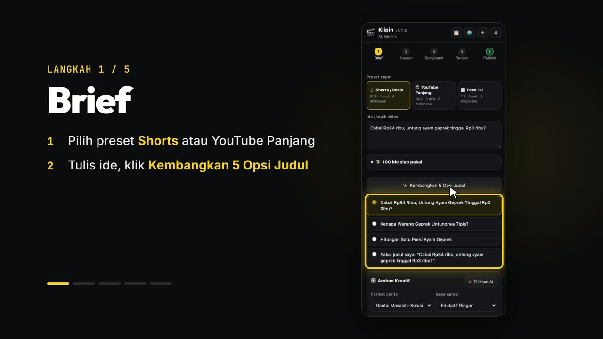

# Klipin 🎬 (Chrome extension, MV3)

Brief → Naskah & Suara → Storyboard → Preview & Render → Publish, semua dari side panel Chrome — bisa **manual per langkah** maupun **⚡ Full Otomatis (1 klik)** hingga **📋 Antrean Batch**.
Gratis & open source (MIT). Tidak ada server eksternal: semua proses (potong jeda, normalisasi loudness, sinkronisasi, render video) berjalan langsung di browser kamu.

## Tutorial video (1,4 menit, versi 1.11)
[](https://github.com/wildanlsfs/klipin/releases/download/v1.11.0/klipin-tutorial.mp4)

Klik gambar di atas untuk menonton / download video tutorial (MP4, 84 detik): pasang dari Releases, isi API key, 5 langkah dari Brief sampai Publish, lalu **⚡ Full Otomatis (1 klik)** dan **📋 Antrean Batch**.

## Pasang
1. Download `klipin-<versi>.zip` dari [Releases](https://github.com/wildanlsfs/klipin/releases/latest)
   (atau tombol hijau **Code → Download ZIP**, atau `git clone https://github.com/wildanlsfs/klipin.git`), lalu **ekstrak**
   ke tempat tetap, mis. `Documents/Klipin`. Jangan dihapus atau dipindah setelah dipasang.
2. Buka `chrome://extensions` → aktifkan **Developer mode** (kanan atas) → **Load unpacked** → pilih folder yang
   **langsung berisi `manifest.json`**.
   - Windows sering membuat folder ganda saat ekstrak (mis. `klipin-1.11.1\klipin\manifest.json`); pilih folder yang di dalam.
3. Klik ikon Klipin → side panel terbuka. Isi minimal satu API key di ⚙︎
   (Gemini gratis: https://aistudio.google.com/apikey). Model bawaan Gemini: `gemini-3.8-flash`.
4. **Update:** saat ada versi baru, bilah hijau muncul di panel. Klik **Download update**, timpa folder lama dengan isi ZIP
   yang baru, lalu klik **Muat ulang Klipin** (atau ↻ di `chrome://extensions`). Pengaturan, API key, dan proyek tidak hilang.

Butuh Chrome 116+ (desktop). Untuk gambar otomatis, login akun Google di [Google Flow](https://flow.google.com); untuk suara gratis otomatis tanpa TTS API key, login di [Google AI Studio](https://aistudio.google.com/generate-speech).

## Cara pakai (dari nol sampai video jadi)
Panel punya 5 langkah di bagian atas (**Brief → Naskah → Storyboard → Render → Publish**). Kamu bisa menjalankannya satu per satu, atau memakai **⚡ Full Otomatis** (lihat bawah).

**Sebelum mulai (sekali saja)**
1. Klik ⚙︎ di kanan atas, isi **Gemini API key** ([ambil gratis](https://aistudio.google.com/apikey)), lalu **Simpan**. Penyedia lain (OpenAI, OpenRouter, Groq, 9Router, dll.) bisa ditambah lewat **+ Tambah provider**.
2. Login akun Google di Chrome yang sama ke [Google Flow](https://flow.google.com) (untuk gambar) dan [Google AI Studio](https://aistudio.google.com/generate-speech) (untuk suara gratis).

**Langkah 1, Brief**
1. Pilih preset: **📱 Shorts / Reels** (9:16, 1 menit), **📺 YouTube Panjang** (16:9, 5 menit), atau **⬜ Feed 1:1**.
2. Tulis ide/topik (atau pilih dari **📚 100 ide siap pakai**), lalu klik **✨ Kembangkan 5 Opsi Judul** dan pilih judul.
3. Di **Arahan Kreatif**, atur format cerita, gaya narasi, durasi, bahasa, loop (Shorts), dan gaya visual (mis. **Stickman Putih**). Atau klik **✨ Pilihkan AI** supaya dipilihkan.

**Langkah 2, Naskah & suara**
1. Klik **📝 Tulis Naskah dari Judul**. Edit naskah kalau perlu.
2. Pilih mesin suara (**AI Studio Auto (Gratis)**, Gemini, atau ElevenLabs) dan narator, lalu klik **⚡ Buat Suara Otomatis**. Untuk AI Studio, Klipin membuka tabnya sendiri, mengisi naskah, menekan Run, dan mengambil audionya. Atau tarik file audio sendiri ke kotak "Tarik file audio ke sini".
3. Jeda dipotong dan volume diratakan otomatis (bisa diulang di **Atur style instruction, AI Studio manual & potong jeda**).

**Langkah 3, Storyboard**
1. Klik **✨ Buat Storyboard**: naskah dipecah jadi scene yang waktunya pas dengan suara.
2. Klik **🎨 Generate Semua Gambar**. Klipin membuka/membuat project Google Flow sendiri dan mengirim prompt 1–5 sekaligus. Scene yang gagal bisa diulang per kartu (↻), diganti (⬆ upload), atau ditukar (⇄).
3. Ubah prompt per scene di kartu bila perlu, lalu **Lanjut ke Preview & Render**.

**Langkah 4, Render**
1. Cek **Pratinjau Frame** (garis **Safe Zone 9:16** menunjukkan area yang aman dari tombol Shorts/Reels), teks hook 2 detik pertama, dan angka penting di layar (**✨ Usulkan** untuk saran AI).
2. Pilih 1080p/720p dan 24/30 fps, lalu klik **🎬 Render MP4**. Hasil tersimpan di folder **Downloads/Klipin**.

**Langkah 5, Publish**
1. Klik **✨ Buat Paket Publish & Konsep Thumbnail**: 5 judul, deskripsi (bab otomatis untuk video ≥ 2 menit), tag, dan konsep thumbnail.
2. Pilih jenis thumbnail, lalu **⬇ Download Thumbnail** atau **📦 Export Metadata**.
3. Klik **⬆ Kirim Video ke YouTube Studio** dan **⬆ Kirim Thumbnail ke Studio** saat dialog upload di studio.youtube.com terbuka. Klipin tidak mempublikasikan video; pilih sendiri jadwal atau visibilitasnya.

**⚡ Full Otomatis (1 klik)**
- Di langkah Brief, tulis topik lalu klik **⚡ Buat Otomatis Sampai Jadi (Full AI)**. Naskah, suara, storyboard, gambar Flow, render, dan paket publish berjalan sendiri. Bilah progres di atas menampilkan tahap aktif; **■ Stop** menghentikannya, dan kalau terhenti di tengah, proyek bisa dilanjutkan dari tahap terakhir (checkpoint).

**📋 Antrean Batch**
- Klik ikon 📋 di kanan atas, tempel daftar topik (satu baris satu video), pilih preset dan sumber suara, **＋ Tambah ke Antrean**, lalu **▶ Jalankan Antrean**. Setiap video disimpan di `Downloads/Klipin/<judul>/`.

## 🤖 Pakai lewat AI agent (Claude, Gemini, Codex, Cursor, LM Studio, …)
Klipin bisa dikendalikan model AI apa pun yang mendukung [MCP](https://modelcontextprotocol.io), tidak hanya Claude. Kamu cukup bilang:
*"Pakai Klipin, buatkan Shorts tentang kenapa petani cabai sering rugi padahal harga pasar melonjak"*, lalu agent menjalankan `klipin_run_pipeline` secara penuh (arahan kreatif otomatis → judul → naskah → suara → storyboard → gambar Flow → render MP4 → paket publish & thumbnail) sampai file siap di `Downloads/Klipin/<judul>/`. Agent juga tetap bisa memanggil tool granular satu per satu (termasuk `klipin_aistudio_voice` untuk suara gratis via tab AI Studio).

**Pasang (sekali saja):**
- **Claude Desktop** (paling mudah, tidak perlu install apa-apa lagi):
  1. Download **`klipin.mcpb`** dari halaman [Releases](https://github.com/wildanlsfs/klipin/releases/latest).
  2. Klik dua kali file itu → Claude Desktop terbuka → klik **Install**.
- **Claude Code, Gemini CLI, Codex CLI, Cursor, Windsurf**: butuh [Node.js](https://nodejs.org/id/download) (versi LTS). Buka folder `mcp` di folder Klipin,
  lalu klik dua kali **`Pasang-Klipin-MCP.command`** (Mac) atau **`Pasang-Klipin-MCP.bat`** (Windows). Skrip ini mendaftarkan
  Klipin ke semua aplikasi yang ditemukan. Tutup lalu buka lagi aplikasinya.
  - Mac menolak membuka file? Klik kanan → **Open** → **Open**.
  - Cara manual (aplikasi lain): `node /path/ke/klipin/mcp/server.mjs` sebagai server MCP stdio.
- **Model/aplikasi lain** (Gemini CLI, Codex, LM Studio, Open WebUI, n8n, agent buatan sendiri): lihat tabel di bawah.

**Cara konek manual per aplikasi** (ganti `/path/ke/klipin` dengan folder tempat kamu mengekstrak Klipin; butuh Node.js 18+):

| Aplikasi | Cara |
| --- | --- |
| Claude Desktop | Klik dua kali `klipin.mcpb` (atau lewat pemasang di atas) |
| Claude Code | `claude mcp add --scope user klipin -- node /path/ke/klipin/mcp/server.mjs` |
| Codex CLI | `codex mcp add klipin -- node /path/ke/klipin/mcp/server.mjs` |
| Gemini CLI | Tambahkan ke `~/.gemini/settings.json`: `{"mcpServers":{"klipin":{"command":"node","args":["/path/ke/klipin/mcp/server.mjs"]}}}` |
| Cursor / Windsurf / VS Code | Tambahkan blok `mcpServers` yang sama ke `~/.cursor/mcp.json` / `~/.codeium/windsurf/mcp_config.json` / pengaturan MCP VS Code |
| LM Studio, Open WebUI, n8n, agent buatan sendiri | Pakai mode HTTP di bawah (atau stdio kalau didukung) |

**Mode HTTP (klien lokal yang tidak bisa stdio):**
1. Jalankan `node /path/ke/klipin/mcp/server.mjs --http` dan biarkan terbuka.
2. Arahkan klien ke `http://127.0.0.1:47816/mcp` dengan header `Authorization: Bearer <token>`. Token didapat dari `node /path/ke/klipin/mcp/server.mjs --token`.
3. Server hanya mendengarkan di `127.0.0.1` dan menolak permintaan tanpa token atau dari halaman web.
- ChatGPT dan layanan berbasis cloud lain tidak bisa menjangkau `127.0.0.1`. Untuk itu butuh terowongan publik (mis. cloudflared atau ngrok); lakukan hanya kalau paham risikonya, karena token menjadi satu-satunya penjaga.
- Model kecil yang salah menulis tipe argumen (angka sebagai teks, daftar sebagai string) tetap diterima karena server memperbaikinya otomatis.
- Klien selain Claude belum diuji langsung; kalau ada yang gagal, laporkan lewat *Issues*.

**Pakai:**
1. Buka Chrome, klik ikon Klipin. Tombol 🤖 di panel memberi titik hijau saat agent terhubung (progres live tampil di bilah Autopilot sticky di panel).
   (Kalau panel belum terbuka saat agent mulai bekerja, Klipin membukanya sendiri di tab dalam ±30 detik.)
2. **Gambar:** pastikan sudah login Google di Chrome — jika belum ada project Flow terbuka, Klipin otomatis membuka `flow.google.com` dan membuat project baru.
3. **Suara:** otomatis memakai TTS API bila key tersedia, atau otomatis menjalankan **Google AI Studio** (`klipin_aistudio_voice`) secara gratis. Kamu juga tetap bisa memuat file audio lokal lewat `klipin_load_audio` (termasuk *"audionya di Downloads"* untuk mengambil file terbaru 30 menit terakhir; di-stream langsung lewat HTTP lokal `/audio/<token>`).
4. **Hasil:** MP4, thumbnail JPG, dan metadata (`.txt` & `.json`) tersimpan rapi di folder **Downloads/Klipin**.

Keamanan: server hanya mendengarkan di `127.0.0.1` dan mewajibkan header klien + `Origin` extension Chrome untuk endpoint panel/audio (opsional kunci ketat ke satu ID extension lewat env `KLIPIN_EXT_ID=<id>`). `klipin_youtube_attach` hanya memvalidasi & mengisi input file pada tab `studio.youtube.com`. API key tetap di extension dan tidak pernah dikirim ke agent. Matikan kapan saja lewat 🤖 → centang "Izinkan AI agent".

## Privasi
- API key disimpan hanya di `chrome.storage.local` di komputermu dan hanya dikirim ke provider yang kamu pilih.
- Proyek, audio, dan media gambar disimpan terpisah di IndexedDB browser kamu (`kv` + `media`). Tidak ada data yang dikirim ke server pembuat extension.

## Multi provider (⚙︎ di side panel, atau halaman Options: klik kanan ikon → Options)
- **Provider teks:** Gemini + sebanyak apa pun endpoint OpenAI-compatible. Preset: OpenAI, OpenRouter, Groq, DeepSeek,
  9Router, Ollama (lokal), Custom. Dropdown model terisi otomatis dari `/models` provider begitu key diisi (↻ untuk muat ulang, atau pilih "Ketik manual…").
- **Tugas → provider:** judul, naskah, prompt scene, transkrip, dan paket publish masing-masing bisa memakai provider berbeda.
- **Cadangan otomatis:** kalau provider gagal (kuota, error, JSON rusak), pindah ke provider lain yang siap.
- **Transkrip:** Gemini (dipecah otomatis per ±90 detik paralel dengan retry per potongan), atau provider dengan *model transkrip* Whisper (OpenAI `whisper-1`, Groq `whisper-large-v3`).
- **Suara (TTS):** **AI Studio Auto (Gratis)**, Gemini TTS API (30 suara bawaan + muat otomatis suara terbaru/custom dari endpoint `/v1beta/voices`), provider dengan *model TTS* (OpenAI `gpt-4o-mini-tts` 13 suara resmi termasuk *Marin* & *Cedar*, muat otomatis `/audio/voices` pada server kompatibel), ElevenLabs (diambil dari akunmu), serta kolom ketik manual nama/ID suara baru.
- **Bahasa global (`EN`):** mode bahasa Inggris memakai panduan prompt khusus bahasa Inggris lisan Amerika yang natural & satuan global (`$`, `%`) untuk judul, naskah, hook layar, callout angka, thumbnail, dan paket YouTube.
- Ollama: jalankan dengan `OLLAMA_ORIGINS="chrome-extension://*"`.

## Aturan prompt, arahan kreatif & 20 gaya visual
- **Arahan kreatif otomatis (`✨ Pilihkan AI`):** berdasarkan topik dan preset, AI otomatis memilihkan format cerita, gaya narasi, gaya visual, mode Loop, dan suara narator paling pas (aktif otomatis di mode `⚡ Buat Otomatis` & `📋 Antrean Batch` selama kamu belum mengubah pilihan secara manual).
- **20 preset gaya visual** dalam 4 kategori (**Edukasi**, **Ilustrasi**, **3D & Miniatur**, **Sinematik & Misteri**) — termasuk *Stickman Putih*, *Whiteboard Spidol*, *Vektor Sains Cerah*, *Diorama 3D Isometrik*, *3D Minimalis Modern*, *Sejarah Flat*, *Paper Cut / Kolase*, *Kartun 2D*, *Komik Retro Pop*, *Cat Air Storybook*, *Anime*, *Tanah Liat Purba*, *Claymation Modern*, *Miniatur Makro*, *Pixel Art Retro*, *Sinematik Realistis*, *Dokumenter Noir*, *Lukisan Klasik*, *Dark Misteri*, dan *Surealis / Liminal*.
  - Klik **`🌊 Buat contoh di Flow`** untuk men-generate contoh gambar `320×200` JPG untuk semua gaya sekaligus via Google Flow (tersimpan di IndexedDB dan diunduh ke `Downloads/Klipin/style-previews/`). Klik `🔍` pada kartu gaya untuk pratinjau besar atau render ulang 1 gaya.
  - Prompt gaya bawaan tetap bisa diganti, dan kamu bisa menambah gaya sendiri di ⚙︎ → 🎨 Gaya visual.
- **Aturan naskah**, **aturan prompt gambar**, dan **aturan thumbnail** di ⚙︎ → ✍️ Aturan prompt bisa dimatikan, diubah, atau ditambah.
  - Termasuk pembuka 3 detik, inti 10 detik, pertanyaan komentar di akhir (Shorts) atau sepertiga awal (video panjang), jalan keluar konkret, tanpa kata pamitan, serta **🔁 Loop** untuk Shorts (penutup menggantung berkoma/titik dua + gaya suara loop; potong jeda ujung dirapatkan ke 25 ms).
  - **Format konten** dengan panduan retensi terpisah: Misteri, Sejarah Penemuan, Bagaimana Jika, Kronologi, Explainer, Biografi, Top List, **Rantai Masalah–Solusi** (125 kata untuk Shorts 1 menit), **Cerita Narasi**, **Seluruh Perjalanan**, dan Investigasi Berita Viral.
  - **Editor retensi:** pemeriksaan otomatis setelah draf naskah ditulis agar bagian yang datar, berulang, atau bocor jawaban langsung diperbaiki.

## Alur (5 Langkah + Autopilot)
1. **Brief & Preset** – Pilih preset 1-klik (**📱 Shorts / Reels** `9:16 · 1 mnt · 4 dtk/scene`, **📺 YouTube Panjang** `16:9 · 5 mnt · 6 dtk/scene`, atau **⬜ Feed 1:1**), tulis topik atau pilih dari 100 ide, klik *Kembangkan 5 Opsi Judul*, atur atau klik **`✨ Pilihkan AI`** untuk arahan kreatif & pilih dari 20 gaya visual.
   - Klik **`⚡ Buat Otomatis Sampai Jadi`** untuk menjalankan seluruh alur tanpa intervensi manual, atau buka **📋 Antrean Batch** di topbar untuk memproses banyak topik berurutan. Bilah progres sticky di atas selalu menampilkan tahap aktif, checklist status, sub-detail, timer berjalan, dan tombol **■ Stop**.
2. **Naskah & Suara** – Tulis/edit naskah (menampilkan progres fase penulisan), lalu buat suara otomatis lewat **✨ AI Studio Auto (Gratis)** (otomatis mengisi prompt & menarik audio dari tab AI Studio) atau TTS API, atau tarik file audio manual. Jeda dipotong dan loudness dinormalisasi otomatis.
3. **Storyboard (Scene + Gambar)** – Daftar scene bertimestamp yang diselaraskan ke jeda nyata di audio digabung langsung dengan kartu pratinjau & aksi gambar (`↻`, `⬆`, `⇄`, `✕`) serta kolom edit prompt per scene. Klik `↗ Buka / Buat Project Flow` atau langsung **`🎨 Generate Semua Gambar`** (otomatis membuka/membuat project Flow, mengirim 1–5 prompt sekaligus, dan melunakkan prompt 1× bila ditolak filter keamanan Flow).
4. **Preview & Render** – **Pratinjau Frame live** dengan slider waktu dan garis batas **Safe Zone 9:16** (mencegah teks/callout tertutup tombol Like/Komentar/Share Shorts & Reels), teks hook 2 detik pertama, catatan angka di layar (*callout*), pilihan 1080p/720p & 24/30 fps, lalu **`🎬 Render MP4`** via WebCodecs (`fastStart: 'fragmented'` saat memakai file picker; fallback GPU → software otomatis).
5. **Publish** – **`✨ Buat Paket Publish & Konsep Thumbnail`**: 1 tombol menghasilkan 5 judul, deskripsi/caption (bab/timestamp otomatis untuk video ≥ 2 menit), tag, serta konsep thumbnail per jenis (*Kontras*, *Reaksi*, *Angka*, *Misteri*, *Momen*, *Tokoh*, *Daftar*). Simpan thumbnail JPG, export metadata (`.txt` & `.json`), atau kirim langsung ke dialog upload YouTube Studio.

## Mengatasi masalah
- **"models/gemini-2.5-flash is no longer available to new users"**: Google menutup model Gemini 2.5 untuk akun baru.
  Update ke versi terbaru, atau ⚙︎ Pengaturan → Gemini → model `gemini-3.8-flash` → Simpan.
- **"Manifest file is missing or unreadable"** saat Load unpacked: folder yang dipilih salah. Pilih folder yang langsung berisi `manifest.json`.
- **Kuota Gemini habis / "limit: 0"**: model Pro tidak tersedia untuk API key gratis. Pakai model Flash, atau tambah provider lain (Groq/OpenRouter) di ⚙︎ sebagai cadangan.
- **Panel tidak berubah setelah update**: pastikan folder yang ditimpa sama dengan yang terpasang di `chrome://extensions`, lalu klik ↻.
- **Google Flow / AI Studio minta login**: buka tab `flow.google.com` atau `aistudio.google.com` di Chrome yang sama dan login manual ke akun Google-mu, lalu ulangi.

## Struktur
- `sidepanel.html`, `sidepanel.css`, `js/app.js` – UI 5 langkah, Pratinjau Frame, Batch Queue UI & koordinasi modul
- `background.js` – service worker MV3, alarm lifecycle, CDP trusted click/type, & file attach YouTube Studio
- `options.html`, `js/settings-ui.js`, `js/options.js` – UI pengaturan multi-provider, aturan prompt, & gaya visual
- `js/data.js` – preset video, 100 ide, format konten, gaya narasi, 20 gaya visual, jenis thumbnail
- `js/llm.js` – multi provider, cadangan otomatis, arahan kreatif otomatis, editor retensi, TTS API, transkrip paralel
- `js/audio.js` – decode, potong jeda (adaptif + loop edge), normalisasi loudness, resample, WAV
- `js/scenes.js` – pemecah kalimat tahan singkatan, DP alignment jeda audio, subtitle cues
- `js/render.js` – `drawFrame()` & render MP4 WebCodecs (`lib/mp4-muxer.mjs`, MIT)
- `js/store.js` – IndexedDB terpisah (`kv` + `media`) dengan proteksi cache preview gaya
- `js/flow-client.js`, `content/flow.js` – otomasi Google Flow (auto-project, paralel batch, policy-soften, crop JPG)
- `js/aistudio-client.js`, `content/aistudio.js` – otomasi Google AI Studio Generate Speech gratis
- `js/thumbnail.js` – canvas renderer thumbnail 16:9 / 9:16 / 1:1
- `js/pipeline.js` – `runFullPipeline()` (checkpoint/resume + progress terstruktur) & antrean batch
- `js/agent.js`, `js/agent-tools.js`, `mcp/` – jembatan & server MCP tanpa dependensi untuk AI agent
- `test/` – unit test bawaan Node (`node --test test/*.test.mjs`)

## Pengujian (untuk developer)
```bash
for f in background.js content/*.js js/*.js mcp/*.mjs; do node --check "$f" || exit 1; done
node --test test/*.test.mjs
```

## Catatan
- Proyek independen, tidak berafiliasi dengan Google. Otomasi Google Flow dan Google AI Studio membaca tampilan halaman web,
  jadi bisa terdampak kalau Google mengubah tampilannya — laporkan lewat *Issues*. Patuhi ketentuan layanan Google dan provider AI yang kamu pakai.
- Pakai dengan bijak: biaya/kuota API ditanggung akun masing-masing.

## Lisensi
MIT — lihat `LICENSE`. `lib/mp4-muxer.mjs` © Vanilagy, MIT (`lib/mp4-muxer.LICENSE`).
