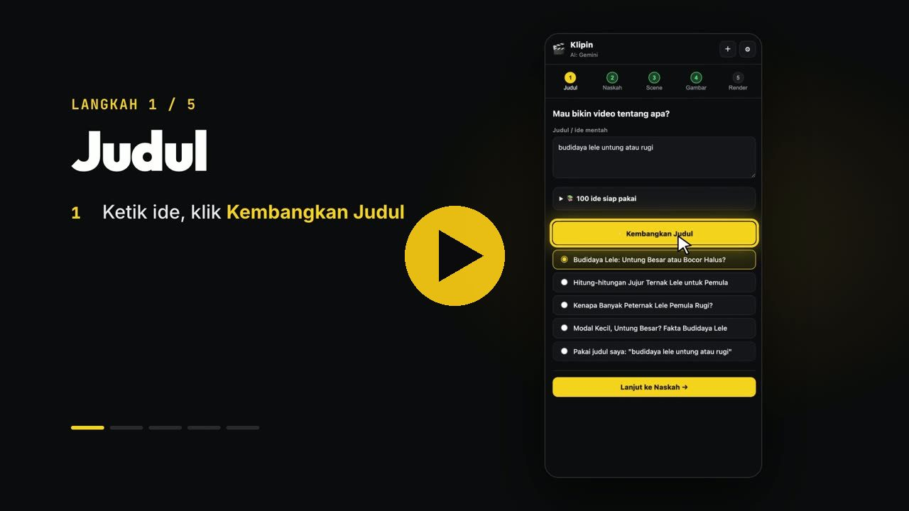

# Klipin 🎬 (Chrome extension, MV3)

Judul → naskah → suara → scene → gambar otomatis di Google Flow → render MP4, semua dari side panel Chrome.
Gratis & open source (MIT). Tidak ada server: semua proses (potong jeda, sinkronisasi, render video) berjalan di browser kamu.

## Tutorial video (1 menit)

Klik gambar di atas untuk menonton / download video tutorial (MP4, 66 detik).

## Pasang
1. Download: tombol hijau **Code → Download ZIP** di halaman ini, lalu ekstrak.
   (Atau `git clone https://github.com/wildanlsfs/klipin.git`)
2. Buka `chrome://extensions` → aktifkan **Developer mode** (kanan atas) → **Load unpacked** → pilih folder hasil ekstrak
   (folder yang berisi `manifest.json`).
3. Klik ikon Klipin → side panel terbuka. Isi minimal satu API key di ⚙︎
   (Gemini gratis: https://aistudio.google.com/apikey).
4. Update ke versi baru: download lagi, timpa folder lama, lalu klik ↻ di `chrome://extensions`.

Butuh Chrome 116+ (desktop). Untuk langkah gambar perlu akun Google Flow (https://flow.google.com).

## Privasi
- API key disimpan hanya di `chrome.storage.local` di komputermu dan hanya dikirim ke provider yang kamu pilih.
- Project (naskah, audio, gambar) disimpan di IndexedDB browser kamu. Tidak ada data yang dikirim ke server pembuat extension.

## Multi provider (⚙︎ di side panel, atau halaman Options: klik kanan ikon → Options)
- **Provider teks:** Gemini + sebanyak apa pun endpoint OpenAI-compatible. Preset: OpenAI, OpenRouter, Groq, DeepSeek,
  9Router, Ollama (lokal), Custom. Dropdown model terisi otomatis dari `/models` provider begitu key diisi (↻ untuk muat ulang, atau pilih "Ketik manual…").
- **Tugas → provider:** judul, naskah, prompt scene, dan transkrip masing-masing bisa memakai provider berbeda.
- **Cadangan otomatis:** kalau provider gagal (kuota, error, JSON rusak), pindah ke provider lain yang siap.
- **Transkrip:** Gemini, atau provider dengan *model transkrip* Whisper (OpenAI `whisper-1`, Groq `whisper-large-v3`).
- **Suara (TTS):** Gemini, provider dengan *model TTS* (OpenAI `gpt-4o-mini-tts` — ikut style instruction), atau ElevenLabs
  (daftar suara diambil dari akunmu). TTS tidak memakai cadangan otomatis supaya suara narator tidak berganti di tengah video.
- Ollama: jalankan dengan `OLLAMA_ORIGINS="chrome-extension://*"`.

## Alur
1. **Judul** – ketik ide / pilih dari 100 ide → *Kembangkan Judul* (atau pakai judul sendiri).
2. **Naskah** – pilih format, gaya narasi, durasi, bahasa → *Tulis Naskah*.
   Suara: *Buka Google AI Studio* (naskah otomatis tersalin), salin style instruction, pilih suara, Run, download,
   lalu tarik file audio ke kotak "Tarik file audio". Alternatif: *generate langsung via Gemini API*.
3. **Scene** – pilih gaya visual & rasio. Jeda/diam dipotong otomatis. *Buat scene dari naskah* (waktu tiap kalimat
   diselaraskan ke jeda nyata di audio) atau *Transkrip otomatis + buat scene* (kalau naskah berbeda dari yang dibacakan).
   *🔁 Sinkronkan ulang* menghitung ulang waktu gambar & subtitle tanpa mengubah gambar. Prompt gambar dibuat AI per batch.
4. **Gambar** – buka sebuah project di Google Flow (flow.google.com), set mode **gambar**, output per prompt = 1 → *Kirim Semua ke Flow*.
   Extension mengetik prompt, mengirim (dan mengulang kalau Flow masih sibuk), menunggu, lalu menarik gambar ke panel.
   Kalau Flow membuat 2+ gambar per prompt, semuanya disimpan — klik **⇄** di gambar untuk memilih. Scene gagal → ↻ atau ⬆ upload manual.
5. **Render** – resolusi 1080/720, FPS 24/30, subtitle → *Render MP4* (pilih lokasi simpan). Encode H.264 + AAC via WebCodecs,
   ±115 fps di 1080p (video 3 menit ≈ 40–50 detik).
6. **YouTube** – *Buat Judul, Deskripsi & Thumbnail*: 5 pilihan judul (≤70 karakter), deskripsi siap tempel dengan hook,
   **bab/timestamp otomatis dari waktu scene**, hashtag, dan tag (≤500 karakter). Thumbnail 1280×720: pilih latar dari gambar scene,
   upload, atau *Buat latar khusus di Flow*; teks besar 2–4 kata (posisi & warna bisa diatur) → *Download Thumbnail (JPG)*.

## Struktur
- `sidepanel.html/css`, `js/app.js` – UI & alur
- `options.html`, `js/settings-ui.js` – UI pengaturan (dipakai side panel & Options)
- `js/llm.js` – multi provider, cadangan otomatis, daftar model, TTS (Gemini/OpenAI/ElevenLabs), transkrip (Gemini/Whisper)
- `js/audio.js` – decode, potong jeda, WAV
- `js/scenes.js` – pembagian scene, penyelarasan kalimat ↔ jeda audio, subtitle
- `js/render.js` – render MP4 (lib/mp4-muxer.mjs, MIT)
- `content/flow.js` – otomasi Google Flow

## Catatan
- Proyek independen, tidak berafiliasi dengan Google. Otomasi Google Flow membaca tampilan halaman Flow,
  jadi bisa rusak kalau Google mengubah tampilannya — laporkan lewat *Issues*. Patuhi ketentuan layanan Google Flow
  dan provider AI yang kamu pakai.
- Pakai dengan bijak: biaya/kuota API ditanggung akun masing-masing.

## Lisensi
MIT — lihat `LICENSE`. `lib/mp4-muxer.mjs` © Vanilagy, MIT (`lib/mp4-muxer.LICENSE`).
